<div align="center">

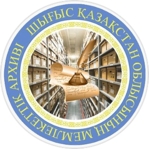

# Государственный архив ВКО: новый сайт

### Осовремененный сайт архива, доступный для всех: учёному, студенту, жителю края и сотруднику архива

**CODEMASTERS HACKATHON 9.0 · Oskemen Hub · команда 2try**


[Презентация](docs/presentation/arhiv-vko-2try.pptx) ·
[Где что лежит](#-содержание-прежнего-сайта) ·
[Быстрый старт](#-быстрый-старт) ·
[Обещания](#-наши-обещания) ·
[Дизайн](#-дизайн) ·
[Принципы](#-принципы) ·
[Технологии](#-технологии-языки-и-методы) ·
[Архитектура](#-архитектура) ·
[API](#-api-сервера)

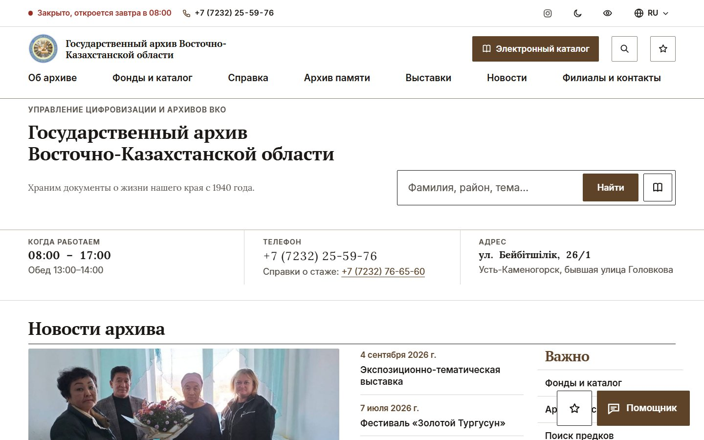

</div>

---

## Коротко

Новый, осовремененный сайт **Государственного архива Восточно-Казахстанской области**. Он доступен для всех, кто обращается в архив: учёных и историков, студентов и журналистов, жителей края и самих сотрудников архива. **Всё содержание прежнего сайта сохранено** и разложено по пяти разделам с вкладками, по нему работают **поиск** и **помощник**, а главная осталась короткой. Сайт говорит на **казахском, русском и английском**. В нём есть **версия для слабовидящих в одну кнопку**, **ИИ-помощник с голосом**, **отзывы и гостевая книга** и **панель для сотрудников**, с которой сайт ведут без программиста.

Весь сайт — **один HTML-файл**. Сервер написан на **Node.js без единой внешней библиотеки**. Запуск с ноутбука с публичной ссылкой — **одна кнопка `start-site.bat`**.

---

## Содержание

1. [Проблема](#-проблема)
2. [Содержание прежнего сайта](#-содержание-прежнего-сайта)
3. [Наши обещания](#-наши-обещания)
4. [Дизайн](#-дизайн)
5. [Принципы](#-принципы)
6. [Что умеет сайт](#-что-умеет-сайт)
7. [Технологии, языки и методы](#-технологии-языки-и-методы)
8. [Архитектура](#-архитектура)
9. [Структура проекта](#-структура-проекта)
10. [Быстрый старт](#-быстрый-старт)
11. [Настройки `.env`](#-настройки-env)
12. [API сервера](#-api-сервера)
13. [Панель сотрудников](#-панель-сотрудников)
14. [ИИ-помощник](#-ии-помощник)
15. [Календарь праздников и статус «открыто»](#-календарь-праздников-и-статус-открыто)
16. [Доступность](#-доступность)
17. [Безопасность и приватность](#-безопасность-и-приватность)
18. [Офлайн-режим и установка на телефон](#-офлайн-режим-и-установка-на-телефон)
19. [Тестирование](#-тестирование)
20. [Сборка из исходников](#-сборка-из-исходников)
21. [Данные и их проверка](#-данные-и-их-проверка)
22. [Дорожная карта](#-дорожная-карта)
23. [Команда, благодарности, лицензии](#-команда-благодарности-лицензии)

---

## 🔥 Проблема

> **Архив хранит память края, но до него трудно дойти даже в интернете.**

Кто приходит на сайт областного архива:

- **Житель края**, которому нужна справка о стаже или документы о родственниках. Ему нужны **четыре ответа**: *где, работает ли сегодня, как позвонить, как доехать*.
- **Учёный, историк, студент или журналист**, которому важны история края, фонды и издания архива.
- **Сотрудник архива**. Ему нужно поменять часы работы перед праздником, написать новость или ответить на отзыв, и не ждать для этого подрядчика.

Что обычно мешает этим людям:

| Барьер | Что чувствует человек |
|---|---|
| Мелкий текст и бледные цвета | «Мелко, ничего не разобрать» |
| Непонятно, работает ли архив сегодня, особенно в праздники и переносы | «Приеду, а там закрыто» |
| Адрес есть, а дороги нет | «Где эта Бейбітшілік, бывшая Головкова?» |
| Не у кого спросить | «Что взять с собой и куда идти?» |
| Сайт меняет только программист | «Новость о переносе выходного вышла через неделю» |
| Слабый интернет в районе | «Страница не грузится» |

**Задача хакатона:** сохранить содержание сайта, сделать его современным и понятным каждому, добавить ИИ-помощника с подсказкой дороги, оценку сайта, отзывы и гостевую книгу. **Без обращений и заявок**: для них есть eOtinish и eGov.

---

## 📂 Содержание прежнего сайта

Всё полезное с прежнего сайта перенесено и разложено по разделам. Старые записи гостевой книги не переносили: в них персональные данные.

### Где что лежит

| Раздел | Вкладки | Что пришло со старого сайта |
|---|---|---|
| **Посетителям** | Архивная справка · Поиск предков · Читальный зал · Здания и филиалы · Услуги и приём · Частые вопросы | Госуслуги, читальный зал и его правила, приём граждан, платные услуги, адреса, телефоны и руководители 13 филиалов |
| **Фонды** | Что хранится · Личные фонды · Базы данных · Издания · Словарь | 10 групп фондов и цифры, 85 личных фондов с фильтром, 4 базы данных, словарь на 44 термина |
| **История края** | Очерки · Выставки · Фотоальбомы · Статьи и доклады · Районы области | Циклы очерков, выставки, фотоальбомы, 107 статей и докладов, действующие и упразднённые районы |
| **Об архиве** | Об архиве · История · Руководство · Планы и отчёты · Документы | 15 вех истории, руководство, планы и отчёты 2010–2026, 36 нормативных актов, антикоррупция |
| **Новости** | Новости · Объявления | 6 последних новостей целиком, архив новостей, действующие объявления |

### Три слоя, чтобы не было нагромождения

1. **Разделы с вкладками.** Длинные списки открываются только по клику. У каждой вкладки свой адрес (`#fonds/personal`), им можно поделиться. Старые ссылки `#history` и `#faq` по-прежнему работают.
2. **Поиск — главное на первом экране.** Большая строка поиска сразу под названием архива, под ней примеры запросов, ниже четыре плитки «Что вам нужно?». Внутри разделов только заголовок и вкладки, второстепенное (подробная хронология, архив новостей, антикоррупция) свёрнуто.
3. **Поиск и помощник.** Поиск идёт по всем вкладкам: фамилия, район, тема. Он прощает опечатки («Ридер» найдёт Риддер), не различает е и ё, подсвечивает найденное, по Enter открывает первый результат. Из результата сайт открывает нужную вкладку и сразу фильтрует список. Если ничего не нашлось, поиск предлагает задать тот же вопрос помощнику или позвонить в приёмную. Помощник перед ответом получает найденные фрагменты и даёт ссылку на вкладку. Без ИИ работает запасной режим: частые вопросы, словарь терминов и тот же поиск.

Длинные тексты прежнего сайта есть только на русском. В казахской и английской версиях это честно помечено над текстом.

<table>
<tr>
<td width="50%">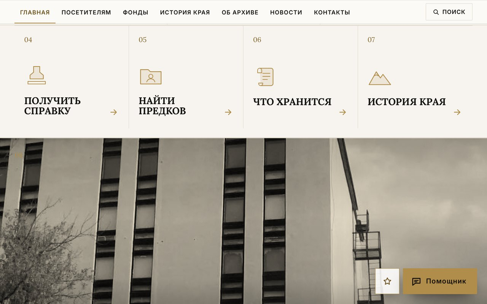<br><sub><b>«Что вам нужно?»</b>: поиск и четыре сценария</sub></td>
<td width="50%">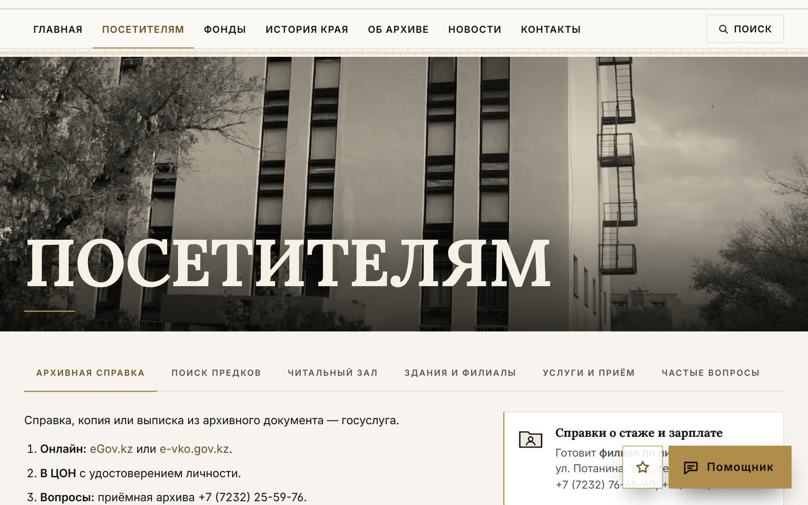<br><sub><b>Раздел с вкладками</b>: справка, предки, читальный зал, филиалы</sub></td>
</tr>
<tr>
<td>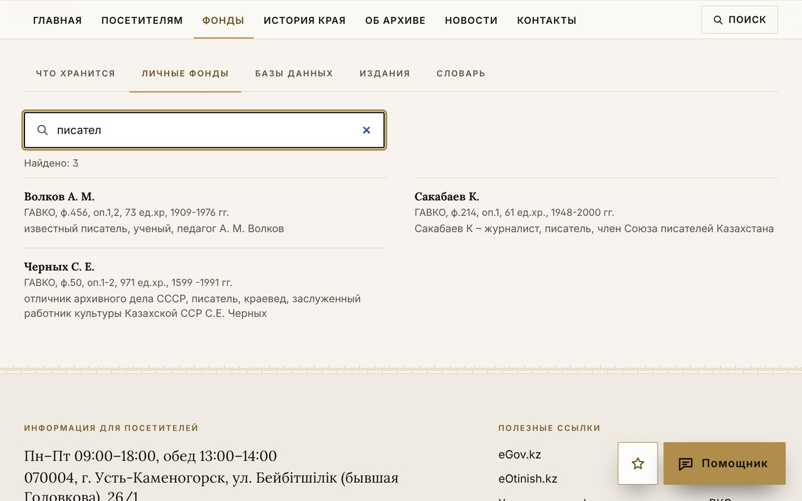<br><sub><b>85 личных фондов</b> с фильтром на лету</sub></td>
<td>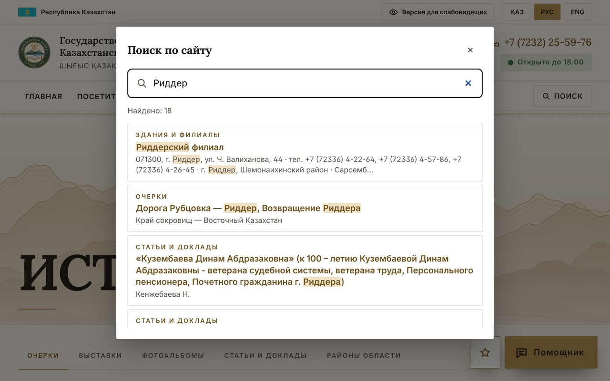<br><sub><b>Поиск по сайту</b>: филиал, очерки, статьи в одном списке</sub></td>
</tr>
</table>

---

## 🤝 Наши обещания

> Каждое обещание держится на конкретной технологии. Ниже сказано, на какой.

| # | Обещание | Что получает человек | Как это сделано |
|:-:|---|---|---|
| 1 | **ОТВЕТ ЗА 5 СЕКУНД** | Телефон и статус «Открыто до 17:00» видны в шапке любой страницы | JavaScript считает статус по времени Өскемена (UTC+5) с учётом праздников РК |
| 2 | **ПРОЧИТАЕТ КАЖДЫЙ** | Пять размеров шрифта, три темы (светлая, тёмная, чёрно-жёлтая), широкий интервал, чтение вслух | CSS Custom Properties, data-атрибуты на `<html>`, Web Speech API (`speechSynthesis`) |
| 3 | **НА РОДНОМ ЯЗЫКЕ** | Қазақша, русский, English, выбор запоминается | Словарь i18n на ~300 ключей, автоопределение по `navigator.languages`, по умолчанию казахский |
| 4 | **ДОРОГА БЕЗ БЛУЖДАНИЙ** | Карта 2ГИС сразу с тремя зданиями (главное выделено), точный маршрут в 2ГИС до каждого, памятка с QR-кодом | MapGL JS API 2ГИС, ссылки на маршрут по координатам и карточкам 2ГИС, свой QR-кодировщик в SVG без интернета |
| 5 | **СПРОСИТЕ, КАК У ЧЕЛОВЕКА** | Помощник отвечает голосом и текстом на трёх языках и строит маршрут | Claude API (Anthropic) через свой сервер, распознавание речи, правила-запасной вариант |
| 6 | **ЧЕСТНО И БЕЗ ЛИШНЕГО** | Нет заявок, рекламы и трекеров, сайт не ставит своих cookies. Отзывы публикуются после проверки | Информационная модель сайта, премодерация, никакой аналитики |
| 7 | **РАБОТАЕТ ПРИ СЛАБОЙ СВЯЗИ** | Сайт ставится на телефон как приложение и открывается без сети | PWA: Service Worker, Cache API, Web App Manifest |
| 8 | **СОТРУДНИК СПРАВИТСЯ САМ** | Новости, тексты, фото, часы, телефоны, выходные и модерация в одной панели | Панель на том же сайте, вход по паролю, сжатие фото в браузере (Canvas) |
| 9 | **БЕЗОПАСНО ПО УМОЛЧАНИЮ** | Ключ ИИ и пароль не попадают в браузер, служебные файлы закрыты | Белый список файлов, сравнение пароля за постоянное время, лимиты запросов |

---

## 🎨 Дизайн

- **Сетка-опись.** Главная собрана из блоков, разделённых тонкими линиями, у каждого блока свой номер 01–12, как в архивной описи: часы, телефон, адрес, четыре дороги, панорама, «С 1940 года», история края, новости, карта.
- **Панорамы.** Между блоками и в шапке каждого раздела — панорамы во всю ширину: здание в золотом монохроме, хребты Алтая с Иртышом и архивные стеллажи (рисуются кодом). Если сотрудники загрузят в панели свои фото для панорам, сайт покажет их.
- **Шрифт:** Lora для заголовков (антиква с мягким, почти рукописным рисунком, подходит архиву), Inter для текста, меню и кнопок. Оба встроены в страницу, все буквы казахского алфавита на месте.
- **Первый экран — официально.** Над фото — ведомство (Управление цифровизации и архивов ВКО) и полное название архива в две строки на языке страницы, под ним золотая черта, поиск и подсказки. На телефоне название уже есть в шапке, поэтому на фото остаются статус и поиск.
- **Крупные цифры по ширине.** «1940» и подпись в подвале подгоняются скриптом по реальной ширине шрифта: на телефоне и на большом мониторе встают ровно, не обрезаются и не наползают друг на друга.
- **Цвет:** светлая тема по умолчанию — кремовый фон, графит и золото; тёмная и чёрно-жёлтая контрастная — в «Версии для слабовидящих». Панорамы, нарисованные кодом, перерисовываются под выбранную тему.
- **Геометрия:** золотая розетка-шаңырақ — окружности, 36 лучей, восьмиконечная звезда, звёзды {12/5} и {16/7}, три пары уықов. Строится кодом (SVG), прорисовывается линия за линией при появлении и медленно вращается: на первом экране, за «1940», в шапке каждого раздела и в подвале. На карточках «Что вам нужно?» при наведении проступает геометрический узор.
- **Переходы:** смена страниц — геометрическая «шторка» с наклонным краем (View Transitions API), смена вкладок — мягкий подъём панели. В браузерах без поддержки страницы просто сменяются.
- **Движение:** медленное приближение фото, название проявляется, при прокрутке уходит вверх, а розетка поворачивается (scroll-driven animations). Заголовки проявляются из-под маски, цифры фондов и годы набегают, сверху — золотая полоса прогресса прокрутки, кнопки заливаются золотом слева направо. Если в системе включено «уменьшить движение», всё это выключается.
- **Наглядно вместо текста.** Режим работы — неделя из семи плашек (рабочие дни золотые, сегодня в рамке), «Что вам нужно?» — крупные иконки и короткие заголовки, «С 1940 года» — три большие цифры и линия времени с точками.
- **Коротко.** На первом экране только название, поиск и две кнопки. Длинные каталоги (личные фонды, документы, статьи, словарь) показываются по 12 строк, остальное — по кнопке «Показать все» или через фильтр, описания — в две строки, полный текст по нажатию. Подвал без повторного меню.
- **Ничего не закрывает первый экран.** Кнопки «Помощник» и «Отзыв» в углу появляются, только когда прокрутишь фото; на первом экране помощник открывается кнопкой рядом с «Позвонить». На телефоне шапка компактная, а звонок, карта, отзыв и помощник — в нижней панели.
- **Наш край:** тонкая золотая линия казахского орнамента, символика РК и Өскемена в шапке, логотип архива.

<table>
<tr>
<td width="50%"><br><sub><b>Первый экран</b>: фото во весь экран, официальное название, поиск</sub></td>
<td width="50%"><br><sub><b>«Что вам нужно?»</b>: четыре дороги, затем «с 1940 года»</sub></td>
</tr>
</table>

---

## 🧭 Принципы

| Принцип | Что это значит | Как проявляется в коде |
|---|---|---|
| **Простота сильнее эффектности** | Семь пунктов меню, длинное спрятано во вкладки, крупные кнопки | Минимум вложенности, крупные кнопки и поля, спокойная типографика PT Serif и PT Sans |
| **Доступность с первого экрана** | Версия для слабовидящих не прячется в подвале | Кнопка в верхней полосе, `aria-*`, видимый фокус, `prefers-reduced-motion`, ссылка «к содержанию» |
| **Государственный язык первым** | Казахский в переключателе стоит первым и выбирается, если язык браузера неизвестен | `detectLang()` → `kz` по умолчанию, `lang="kk"` |
| **Правда вместо догадок** | Мы не выдумываем факты. Чего не знаем, то честно помечаем | Даты сверены по источникам, цифры фондов даны «на 01.01.2020», как на старом сайте; непроверенные телефоны убраны |
| **Ноль зависимостей** | Нечему устаревать и ломаться | Нет npm-пакетов. Node.js: `http`, `fs`, `crypto`. Клиент — чистый JavaScript |
| **Прогрессивное улучшение** | Сайт работает как файл, лучше с сервером, лучше всего с ИИ | Три режима хранилища: `local` → `api` → `db`, запасной помощник на правилах |
| **Приватность** | Мы не следим за посетителями | Сайт не ставит cookies и не подключает аналитику. В `localStorage` — настройки шрифта, темы и языка, а в режиме «файл» ещё и записи |
| **Наш край в каждой детали** | Казахский орнамент, символика РК и Өскемена, свой логотип | Тонкая золотая линия орнамента, символы в шапке, золото и графит как в национальном орнаменте |

---

## ✨ Что умеет сайт

Кратко, без подробностей:

| Для посетителя | Для сотрудника |
|---|---|
| Главная: поиск, быстрые ссылки (каталог, выставки, филиалы, архив памяти), «История в документах», выставки, филиалы на карте, новости, полезное, соцсети | Сводка: оценка сайта, ожидающие проверки, вопросы помощнику |
| **Электронный каталог** (`#catalog`): 1 712 записей прежнего сайта — фонды, описи, дела, рассекреченные документы, фото, карты, публикации, видео; смысловой и расширенный поиск, фильтры, сортировка, карточка с шифром, просмотр с увеличением, избранное | **Каталог и материалы**: карточки, выставки и события «Архива памяти» со статусами Черновик → На проверке → Одобрено → Опубликовано (или «Требует доработки», «Архивировано»); импорт и экспорт CSV с проверкой обязательных полей |
| **Архив памяти** (`#memory`): хронология, шкала материалов по десятилетиям, 315 человек (герои, почётные граждане, фондообразователи), коллекции, публикации | **Распознавание (ИИ)**: скан → текст, название, дата, имена, места → сотрудник проверяет → карточка уходит на проверку |
| **Онлайн-выставки** (`#expo`): 6 выставок архива и 21 фотовыставка, экспонаты по порядку, увеличение, листание | **Аналитика**: популярные разделы, частые запросы и запросы без результатов, языки, рекомендации (без личных данных) |
| **Справка для посетителей**: о сайте, как искать в каталоге, шифры и статусы доступа, справки, предки, читальный зал, вопросы, документы и ссылки — без заявлений и платежей | **Пользователи и роли**: главный администратор, администратор сайта, редактор, сотрудник, администратор филиала, модератор, аналитик; **журнал действий** |
| **Филиалы и контакты**: все здания и филиалы области на карте, поиск, фильтр, карточка, маршрут от «моего местоположения» или адреса, расстояние, 2ГИС и Google | Новости на трёх языках |
| Об архиве: история, руководство, планы и отчёты, документы, символика | |
| Поиск по всему сайту и фильтры внутри длинных списков | |
| Контакты: карта с переключателем трёх зданий, часы, телефоны, памятка с QR | Тексты «Об архиве», филиалы, вопросы и ответы |
| Версия для слабовидящих, три языка, чтение вслух | Фото: загрузка с автоматическим сжатием |
| ИИ-помощник с голосом и маршрутом | Настройки: адрес, телефоны, почта, другие здания, часы, читальный зал, свои выходные |
| Оценка сайта, отзывы и гостевая книга в боковой панели | Журнал вопросов помощнику: видно, чего людям не хватает |
| Нижняя панель на телефоне: Позвонить, Карта, Отзыв, Помощник | |

<table>
<tr>
<td width="50%">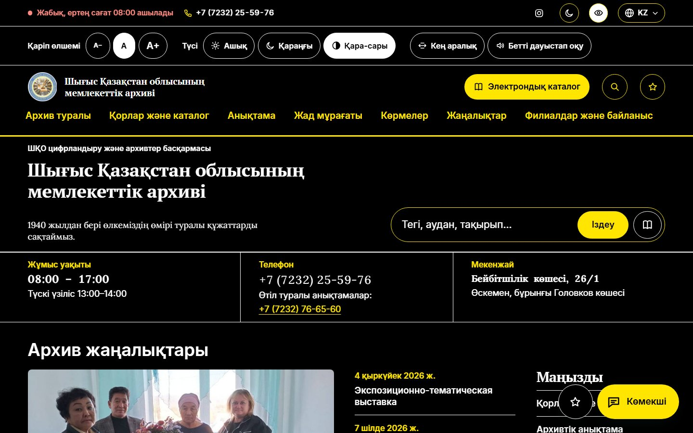<br><sub><b>Версия для слабовидящих</b>: чёрно-жёлтая тема, крупный шрифт, казахский язык</sub></td>
<td width="50%">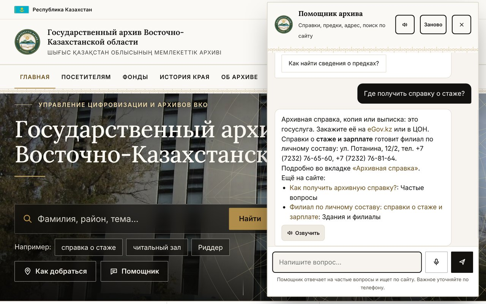<br><sub><b>Помощник</b>: «Где получить справку о стаже?» и ссылки на нужные вкладки</sub></td>
</tr>
<tr>
<td>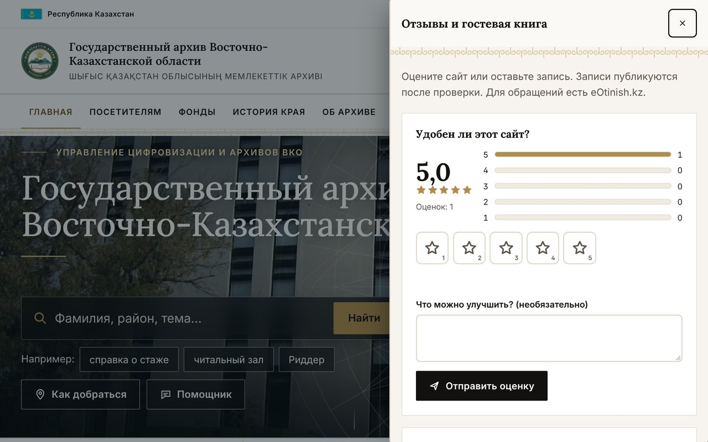<br><sub><b>Отзывы и гостевая книга</b> сбоку и не мешают</sub></td>
<td>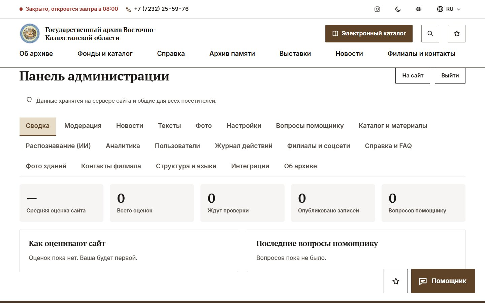<br><sub><b>Панель сотрудников</b>: семь вкладок, без программиста</sub></td>
</tr>
<tr>
<td align="center">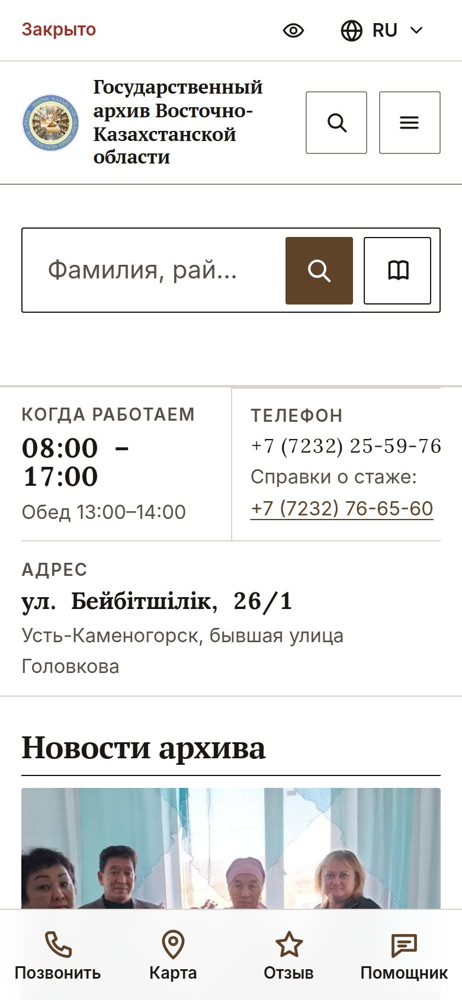<br><sub><b>Телефон</b>: четыре кнопки всегда под пальцем</sub></td>
<td align="center">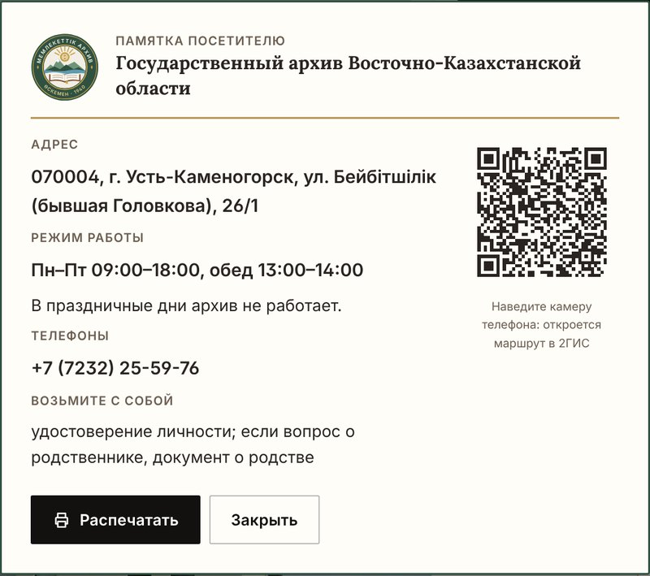<br>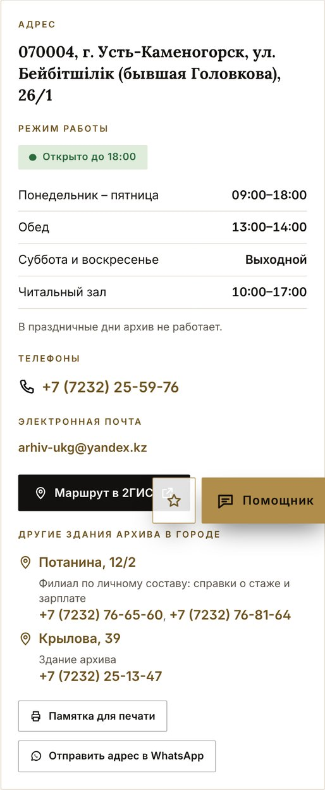<br><sub><b>Памятка с QR</b> и <b>контакты</b>: приёмная, почта, три здания</sub></td>
</tr>
</table>

---

## 🛠 Технологии, языки и методы

### Языки программирования и разметки

Объём замерен по исходникам.

| Язык | Где используется | Объём | Зачем |
|---|---|---:|---|
| **JavaScript (ES2020+)**, браузер | `dev/src.html` → `index.html` | ≈ 2 330 строк своего кода + ≈ 1 250 строк встроенного QR-кодировщика | Интерфейс, i18n, доступность, статус работы, хранилище, помощник, панель |
| **JavaScript (Node.js, CommonJS)** | `server.js`, `tools/launch.js`, `tests/smoke.js`, `sw.js` | ≈ 245 + 255 + 95 + 26 строк | Сервер и API, запуск с туннелем, тесты, офлайн-кэш |
| **CSS3** | `<style>` в `src.html` | ≈ 990 строк | Темы на CSS-переменных, адаптивная вёрстка (Flexbox, Grid, container queries), анимации, печать памятки |
| **HTML5 + SVG** | `src.html` | ≈ 610 строк, 48 SVG-символов | Семантическая разметка, иконки, логотип, герб, книжные полки, орнамент |
| **Python 3** | `dev/build.py`, `tests/layout.py`, `tests/contrast.py` | ≈ 140 + 240 + 170 строк | Сборщик (SVG-орнамент, встраивание фото, герба и шрифтов в base64) и проверка вёрстки в Playwright |
| **Batch (cmd.exe)** | `start-site.bat` | 34 строки | Запуск в Windows одной кнопкой, установка Node.js через winget |
| **POSIX shell** | `start-site.sh` | 7 строк | Запуск на macOS и Linux |
| **JSON** | `manifest.webmanifest`, `package.json`, база `data/db.json`, JSON-LD | — | Манифест PWA, настройки проекта, данные, разметка для поисковиков |

### Технологии по слоям

| Слой | Технология | Как используется |
|---|---|---|
| Интерфейс | **Vanilla JavaScript**, без фреймворков | Один файл, никаких сборщиков npm. Состояние в data-атрибутах и объекте `Store` |
| Стили | **CSS Custom Properties**, Flexbox, Grid, `@media`, `@media print` | Три темы (`data-scheme`), масштаб шрифта (`data-fs`), интервал (`data-spacing`), печать памятки |
| Шрифты | **Lora** (Cyreal, SIL OFL) и **Inter** (Rasmus Andersson, SIL OFL) | Встроены в страницу подмножествами WOFF (≈ 175 КБ, Lora — переменная, жирность 400–700): латиница, кириллица, казахские ә ғ қ ң ө ұ ү һ і, знак ₸. Работают без интернета |
| Графика | **Inline SVG** (`<symbol>` и `<use>`) | Иконки, логотип, герб, книжные полки, казахский орнамент. Ни одной внешней картинки, кроме фото |
| Голос | **Web Speech API**: `speechSynthesis`, `SpeechRecognition` | Чтение страницы и ответов вслух, вопрос помощнику голосом |
| Офлайн | **Service Worker**, **Cache API**, **Web App Manifest** | Network-first для страницы и API, cache-first для картинок и иконок |
| Хранение в браузере | `localStorage` | Настройки шрифта, темы, языка. В режиме «файл» также отзывы |
| Изображения | **Canvas API** | Сжатие загружаемых фото до 1280 px прямо в браузере |
| QR | **QRCode for JavaScript** (Kazuhiko Arase, MIT), встроен | Кодирование в SVG без интернета, коррекция ошибок уровня M |
| Карты | **MapGL JS API 2ГИС** (векторная, ключ из Менеджера Платформы), запасной **RasterJS API**, ссылки **2ГИС** на маршрут и карточку | Три здания на одной карте, главное выделено, по клику — карточка с маршрутом; без сети — схема с теми же точками |
| ИИ | **Claude API (Anthropic Messages API)**, модель по умолчанию `claude-haiku-5-5` | Ответы на вопросы с фактами из настроек сайта |
| ИИ в превью claude.ai | **Artifact runtime**: `window.claude.use('sample')`, tool use | Инструменты `route_links` и `open_page` |
| Сервер | **Node.js 20.6+**: `node:http`, `node:fs`, `node:crypto` | REST API, статика по белому списку, сессии, лимиты |
| База данных | **JSON-файл** с атомарной записью (`write` во временный файл → `rename`) | Отзывы, гостевая книга, новости, настройки, фото, вопросы |
| Публикация с ноутбука | **Cloudflare Tunnel** (`cloudflared`, quick tunnel) | Публичная HTTPS-ссылка `*.trycloudflare.com` без регистрации и белого IP |
| Поисковики и соцсети | **Open Graph**, **JSON-LD** (`schema.org/ArchiveOrganization`, `GovernmentOrganization`) | Превью ссылки в WhatsApp и Telegram, карточка организации в поиске |
| Тесты | **Node.js `assert`** + `fetch`; **Playwright** + headless Chrome; **OpenCV** | Smoke-тесты API; сквозные проверки интерфейса; распознавание QR-кода |

### Методы и приёмы

- **Прогрессивное улучшение.** Один и тот же `index.html` работает в трёх режимах. Режим выбирается сам: проверкой `window.claude` и запросом `/api/health`.
- **Сборка в один файл.** `build.py` подставляет сгенерированные SVG и фото в base64 вместо меток `@@PLACEHOLDER@@`. Сайт можно унести на флешке.
- **Темизация через CSS-переменные.** Светлая, тёмная и контрастная схемы — это наборы переменных, а не разные стили.
- **Интернационализация словарём.** Каждая строка хранится тройкой `[ru, kz, en]`. Атрибуты `data-i`, `data-ip`, `data-ia` переводят текст, подсказки и `aria-label`.
- **Казахские даты и числа без браузера.** В Chrome нет казахских названий месяцев (он пишет «2026 M10 1») и казахских правил чисел (пишет «4.5»). Сайт собирает «1 қазан 2026 ж.» и «4,5» сам.
- **Гроундинг ИИ без базы знаний.** Перед каждым вопросом клиент собирает системную инструкцию с актуальными фактами: адрес, телефоны, часы, праздники на 60 дней вперёд, филиалы, история, публикации. Сервер добавляет свою рамку: только тема архива.
- **Запасной помощник на правилах.** Намерения ищутся по ключевым словам на трёх языках: часы, дорога, телефон, документы, обращения, приветствие и другие. Ответы строятся из шаблонов с данными из настроек.
- **Календарь праздников РК.** Список фиксированных дат. Праздник в выходной переносится на ближайший рабочий день. Рождество и Курбан айт без переноса. Сотрудник может добавить свои даты.
- **Премодерация.** Запись видна всем только после одобрения. У оценок звёзды учитываются сразу, а текст — после проверки.
- **Защита API.** Лимит запросов по IP в фиксированном окне, пароль сравнивается через SHA-256 и `timingSafeEqual`, токен — 32 случайных байта, срок 12 часов.
- **Безопасная статика.** Сервер отдаёт только `index.html`, `sw.js`, манифест, `img/` и `icons/`. Всё остальное, включая `server.js` и `.env`, отвечает 404.
- **Сжатие изображений на клиенте.** Canvas уменьшает фото до 1280 px, итоговый data-URL меньше ~235 000 символов.
- **Кодирование QR в SVG.** Матрица модулей рисуется путём `<path>`, с белой рамкой в 4 модуля, без canvas и без сети.

---

## 🏗 Архитектура

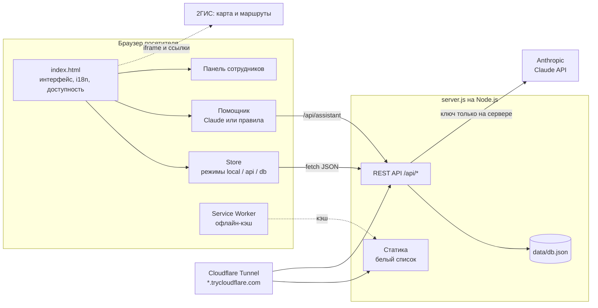

### Три режима одного файла

| Режим | Когда включается | Где хранятся отзывы | Помощник | Вход в панель |
|---|---|---|---|---|
| `local` | `index.html` открыт как файл | `localStorage` этого браузера | Правила на трёх языках | Демо-пароль `arhiv2026` |
| `api` | Сайт открыт с `server.js` (отвечает `/api/health`) | `data/db.json` на сервере, общие для всех | Claude через сервер, если задан ключ, иначе правила | Пароль из `.env` |
| `db` | Сайт открыт как артефакт в claude.ai | База артефакта (`window.claude.use('db')`) | Claude через `window.claude.use('sample')` с инструментами | Владелец артефакта |

### Как проходит вопрос помощнику

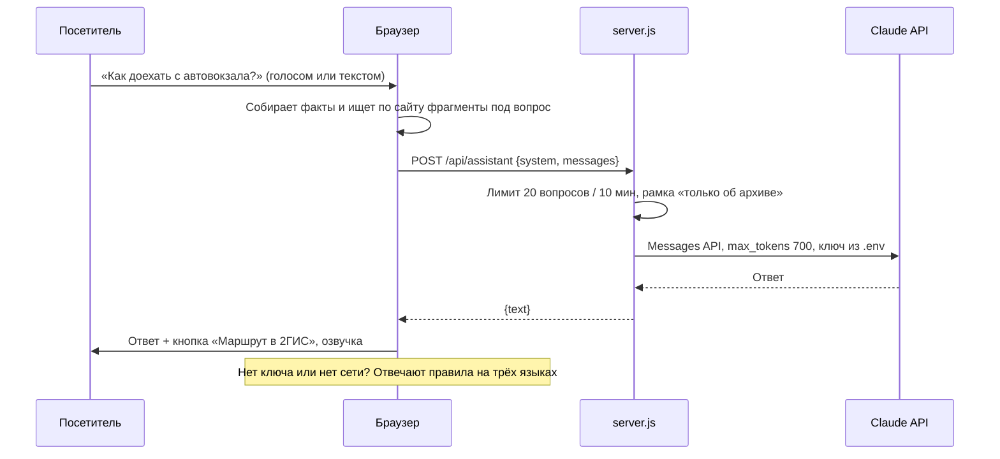

---

## 📁 Структура проекта

```text
arhiv-vko/
├── index.html              # готовый сайт одним файлом (фото и герб внутри)
├── server.js               # сервер: API, база, вход, прокси к ИИ (Node.js, 0 зависимостей)
├── sw.js                   # Service Worker: офлайн-режим
├── manifest.webmanifest    # манифест PWA: имя, цвета, иконки
├── news-seed.json          # новости прежнего сайта: стартовые для сервера (делает сборщик)
├── start-site.bat          # Windows: запуск одной кнопкой с публичной ссылкой
├── start-site.sh           # macOS и Linux: то же самое
├── pages/
│   ├── c*.json             # полные тексты страниц прежнего сайта (грузятся по требованию)
│   ├── catalog.json        # электронный каталог: 1 712 записей (делает tools/build_tz.py)
│   ├── memory.json         # «Архив памяти»: люди, хронология, шкала по десятилетиям
│   ├── expo.json           # онлайн-выставки
│   └── home.json           # главная: «История в документах» и выставки
├── tools/
│   ├── launch.js           # сценарий запуска: .env, сервер, Cloudflare Tunnel, site-access.txt
│   ├── build_tz.py         # данные каталога, архива памяти и выставок из выгрузки прежнего сайта
│   ├── build_pages.py      # тексты страниц прежнего сайта → pages/c*.json
│   ├── upscale.py          # апскейл фото нейросетью Real-ESRGAN (--model best|fast)
│   └── models/             # realesrgan-x4plus.onnx (best) и realesr-general-x4v3.onnx (fast)
├── tests/
│   ├── smoke.js            # npm test: 28 проверок сервера и 20 проверок форматов
│   ├── layout.py           # проверка вёрстки: 1890 экранов, ничего не вылезает за рамки
│   └── contrast.py         # проверка контраста текста по WCAG 2.1 AA
├── icons/                  # иконки приложения 192 и 512 px
├── img/                    # фото здания и герб Өскемена
├── docs/screenshots/       # снимки для этого README
├── docs/presentation/      # презентация для защиты (PowerPoint, 12 слайдов, переход «Трансформация»)
├── dev/
│   ├── src.html            # исходник сайта
│   ├── content.js          # содержание прежнего сайта: фонды, филиалы, статьи, законы, словарь, новости
│   ├── tz.js, tz.css       # разделы по ТЗ: каталог, архив памяти, выставки, филиалы, справка, роли в админке
│   ├── fonts/              # Lora и Inter (WOFF-подмножества, SIL OFL) — встраиваются в страницу
│   └── build.py            # сборщик index.html (Python 3)
├── package.json            # npm-скрипты: start, start:public, test, build
└── .env.example            # пример настроек
```

Создаются при работе (в репозиторий не кладутся): `.env`, `data/db.json`, `data/backups/`, `data/old-cache/`, `site-access.txt`, `tools/bin/cloudflared`.

Пересборка данных разделов по ТЗ: `python tools/build_tz.py ../data/old-site/vko_site_data.json`, затем `python dev/build.py`.

---

## 🚀 Быстрый старт

### Способ 1. Одна кнопка на Windows (для показа)

1. Скачайте и распакуйте проект.
2. Дважды щёлкните **`start-site.bat`**.
3. При первом запуске:
   - если нет Node.js, сценарий установит его через `winget`. После этого запустите `.bat` ещё раз;
   - он спросит ключ ИИ. Можно просто нажать Enter;
   - один раз скачает `cloudflared` (около 60 МБ).
4. Через минуту откроется ссылка вида `https://….trycloudflare.com`. Она работает на любом телефоне.
5. Ссылка и пароль панели сохраняются в **`site-access.txt`**.

> Сайт работает, пока открыто окно и компьютер не спит. Ссылка меняется при каждом запуске. Наружу открыты только файлы сайта.

На macOS и Linux: `./start-site.sh`. На macOS сначала `brew install cloudflared`.

### Способ 2. Просто открыть файл

Дважды щёлкните `index.html`. Всё работает. Отзывы сохраняются только в этом браузере, помощник отвечает по правилам, вход в панель по демо-паролю `arhiv2026`.

### Способ 3. Свой сервер

```bash
cp .env.example .env      # впишите ADMIN_PASSWORD и, если есть, ANTHROPIC_API_KEY
npm start                 # то же: node --env-file=.env server.js
npm test                  # 28 проверок сервера + 20 проверок TIFF и Excel
```

Откройте <http://localhost:3000>.

### Способ 4. Хостинг с доменом

Подойдёт любой VPS с Node.js 20.6+. Перед сервером поставьте nginx с HTTPS: без HTTPS не работают офлайн-режим и установка на телефон.

<details>
<summary>Пример nginx и systemd</summary>

```nginx
server {
  listen 443 ssl http2;
  server_name e-arhiv.example.kz;
  ssl_certificate     /etc/letsencrypt/live/e-arhiv.example.kz/fullchain.pem;
  ssl_certificate_key /etc/letsencrypt/live/e-arhiv.example.kz/privkey.pem;
  client_max_body_size 2m;
  location / {
    proxy_pass http://127.0.0.1:3000;
    proxy_set_header Host $host;
    proxy_set_header X-Forwarded-For $remote_addr;
  }
}
```

```ini
# /etc/systemd/system/arhiv.service
[Unit]
Description=Сайт Государственного архива ВКО
After=network.target

[Service]
WorkingDirectory=/opt/arhiv-vko
ExecStart=/usr/bin/node --env-file=.env server.js
Environment=HOST=127.0.0.1
Restart=always
User=www-data

[Install]
WantedBy=multi-user.target
```

</details>

> Адрес `e-arhiv.vko.gov.kz` принадлежит архиву. Направить его на новый сервер могут только их IT-специалисты.

---

## ⚙ Настройки `.env`

| Переменная | По умолчанию | Назначение |
|---|---|---|
| `PORT` | `3000` | Порт сервера. Сценарий запуска сам найдёт свободный, если этот занят |
| `HOST` | все адреса | Адрес прослушивания. `tools/launch.js` ставит `127.0.0.1`, чтобы снаружи был только туннель |
| `ADMIN_PASSWORD` | — | Пароль панели сотрудников. Без него вход выключен. Сценарий запуска придумывает случайный |
| `ANTHROPIC_API_KEY` | пусто | Ключ Claude API. Без него помощник отвечает по правилам. В браузер ключ не попадает |
| `AI_MODEL` | `claude-haiku-5-5` | Модель помощника |
| `TG_BOT_TOKEN`, `TG_CHAT_ID` | пусто | Необязательно. Если заданы оба, уведомление «материал на проверку» дублируется в Telegram-чат редакторов (ТЗ 6.7) |
| `DATA_FILE` | `./data/db.json` | Где хранить базу. Для резервной копии достаточно скопировать этот файл |

---

## 🔌 API сервера

Все ответы в JSON, `Cache-Control: no-store`. Лимиты указаны на один IP. За Cloudflare IP берётся из `CF-Connecting-IP`.

| Метод | Путь | Доступ | Что делает | Лимит |
|---|---|---|---|---|
| `GET` | `/api/health` | все | `{ok, ai}`: работает ли сервер и подключён ли ИИ | — |
| `GET` | `/api/public` | все | Одобренные записи, звёзды оценок, новости, настройки, фото | — |
| `POST` | `/api/guestbook` | все | Запись `{name, city, text, lang}` уходит на проверку | 5 / 10 мин |
| `POST` | `/api/reviews` | все | Оценка `{stars 1–5, text}` | 5 / 10 мин |
| `POST` | `/api/questions` | все | Журнал вопросов помощнику `{q, lang}` | 60 / 10 мин |
| `POST` | `/api/assistant` | все | `{system, messages}` → `{text}`, прокси к Claude | 20 / 10 мин |
| `POST` | `/api/login` | все | `{login, password}` → `{token, user, perms}`; выход после часа бездействия, не позже 12 часов; 5 ошибок по логину — пауза 15 мин | 8 / 10 мин |
| `POST` | `/api/stat` | все | Обезличенная статистика: раздел, запрос, «ничего не найдено» (без IP) | 300 / 10 мин |
| `POST` | `/api/ai/summary` | все | `{title, text, lang}` → `{summary, dates, names}` (нужен ключ ИИ) | 20 / 10 мин |
| `GET` | `/robots.txt`, `/sitemap.xml` | все | Для поисковиков: ~1 200 адресов с языковыми версиями | — |
| `GET` | `/feed.xml` | все | RSS: новости и выставки (подписка из «Мой кабинет») | — |
| `GET` | `/docs/compliance/<имя>.pdf` | все | Документы комплаенс-службы из `public-docs/compliance/` (потоком) | — |
| `GET` | `/docs/prices/<имя>.pdf` | все | Постановление и прейскурант платных услуг из `public-docs/prices/` (потоком) | — |
| `GET` | `/pages/calendar.json` | все | Календарь памятных дат 2022–2026 (рус. и каз.) | — |
| `POST` | `/api/admin/notes/seen` | сотрудник | Отметить уведомления о согласовании прочитанными | — |
| `GET` | `/catalog/ID`, `/expo/ID`, `/p/ID`, `/memory`… | все | Понятные адреса: сайт с заголовком, описанием и `canonical` нужной страницы | — |
| `GET` | `/api/admin/state` | сотрудник | База по правам роли: материалы, пользователи (без паролей), журнал, статистика | — |
| `PUT` / `DELETE` | `/api/admin/items` | по роли | Карточка каталога, выставка или событие со статусом; публикует модератор или администратор | — |
| `POST` | `/api/admin/items/bulk` | по роли | Импорт строк CSV → «На проверке», ошибки по строкам | до 4 МБ |
| `POST` | `/api/admin/ocr` | по роли | Скан `data:image/…` до 5 МБ → текст и метаданные (ИИ) | — |
| `GET` / `POST` | `/api/admin/stats`, `/api/admin/insights` | аналитик | Статистика и рекомендации ИИ по обезличенным цифрам | — |
| `PUT` / `DELETE` | `/api/admin/users` | главный администратор | Пользователи и роли; пароль хранится как хеш scrypt | — |
| `PUT` | `/api/admin/perms` | главный администратор | Таблица прав ролей `{matrix}` или сброс `{reset:true}`; chief остаётся во всех правах, право `users` не передаётся | — |
| `POST` | `/api/admin/mod` | сотрудник | `{id, status: approved / hidden / pending, reply}` | — |
| `DELETE` | `/api/admin/item` | сотрудник | Удалить запись или отзыв | — |
| `PUT` / `DELETE` | `/api/admin/news` | сотрудник | Добавить, изменить или удалить новость | — |
| `PUT` | `/api/admin/settings` | сотрудник | Адрес, телефоны, другие здания, часы, выходные, тексты | до 300 КБ |
| `PUT` | `/api/admin/branch` | `brinfo` | Контакты филиала `{id, a, p, e, h}` (адрес, телефоны, почта, часы) или `{id, reset:true}`; хранится в `db.brEdits` и отдаётся в `/api/public`; администратор филиала — только свой, главное здание (`gavko`) правится в «Настройках» | — |
| `POST` / `DELETE` | `/api/admin/photos` | по слоту: `photos` или `brphotos` | Фото `data:image/(jpeg/png/webp)` до ~450 КБ; слот `branch` (фото зданий, id `br-<код>`) до ~150 КБ, администратор филиала — только свой | — |
| `POST` | `/api/admin/files?name=…` | право items | Цифровая копия: тело — сам файл. JPG, PNG, WebP до 25 МБ, TIFF до 100 МБ, PDF до 50 МБ; тип по содержимому; PDF со скриптами не принимается | до 100 МБ |
| `POST` / `DELETE` | `/api/admin/files/<id>/view`, `/api/admin/files/<id>` | загрузивший или publish | Облегчённая копия JPEG для показа; удаление неприкреплённого файла | 4 МБ |
| `GET` | `/files/<id>/view`, `/files/<id>/master` | все / сотрудник | Копия для показа — посетителю, если файл прикреплён к опубликованной открытой записи; мастер-копия — сотрудникам | — |

Сотрудник передаёт `Authorization: Bearer <token>`.

---

## 🗂 Панель сотрудников

Откройте `/#admin` и войдите по логину и паролю. Первый вход — логин `admin` и пароль `ADMIN_PASSWORD` из `.env` (главный администратор); дальше он заводит сотрудников во вкладке «Пользователи». Каждый видит только вкладки своей роли.

| Вкладка | Что можно сделать |
|---|---|
| **Сводка** | Средняя оценка, число оценок, ожидающие проверки, последние вопросы помощнику |
| **Модерация** | Одобрить, скрыть или удалить запись и отзыв, ответить на отзыв |
| **Новости** | Написать новость на трёх языках, изменить или удалить |
| **Тексты** | Абзацы «Об архиве», филиалы, вопросы и ответы |
| **Фото** | Загрузить фото в нужное место: главная, «Об архиве», контакты, галерея. Сайт сам его уменьшит |
| **Настройки** | Адрес, телефоны, почта, ключ карты 2ГИС, часы читального зала, другие здания (адрес, назначение, телефоны), часы, обед, объявление, дополнительные выходные |
| **Вопросы помощнику** | Что спрашивают люди, на каком языке и когда |
| **Каталог и материалы** | Карточки каталога, выставки, события хронологии; статусы проверки; импорт и экспорт CSV, шаблон |
| **Распознавание (ИИ)** | Загрузить скан, проверить распознанный текст и поля, отправить карточку на проверку |
| **Аналитика** | Разделы, запросы, «ничего не найдено», языки, рекомендации |
| **Пользователи** | Логины, роли, филиал для администратора филиала, отключение доступа |
| **Журнал действий** | Кто, когда и что изменил (5 000 последних записей) |

---

## 🤖 ИИ-помощник

- **Где:** кнопка «Помощник» внизу справа, на телефоне — в нижней панели.
- **Как спросить:** текстом или голосом через микрофон (`SpeechRecognition`). Ответ можно прослушать, а «автоозвучка» читает каждый ответ сама.
- **Что знает:** всё содержание сайта. Перед каждым вопросом браузер ищет по всем вкладкам и передаёт помощнику до восьми найденных фрагментов со ссылками. Плюс настройки на момент вопроса: адреса и назначение зданий, телефоны, почта, часы, читальный зал, праздники на 60 дней вперёд, филиалы с руководителями.
- **Источники:** кроме фрагментов сайта, браузер ищет по открытому каталогу, «Архиву памяти» (люди), выставкам и фотоальбомам и передаёт помощнику найденные записи с маркерами `[S1]`, `[S2]`. Ссылаться можно только на них: маркеры в ответе превращаются в ссылки на карточки, чужие номера и ссылки на несуществующие разделы отбрасываются. Под ответом: «Найдено на сайте (источники)», «Также найдено по запросу» и «Ещё на сайте по вашему вопросу» (ссылки на разделы есть у каждого ответа). Записи с ограниченным доступом помощнику не передаются.
- **Три ситуации:** ответ с источником, честное «в открытом каталоге ничего не нашлось», отказ по личным делам и закрытым данным (с законным путём: справка на eGov.kz или в ЦОН, читальный зал). Под каждым ответом пометка «сформирован автоматически, это не архивная справка». Подробнее и сценарий показа: [docs/AI-DEMO.md](docs/AI-DEMO.md).
- **Что делает сверх ответа:** на вопрос о дороге показывает кнопку маршрута в 2ГИС до главного здания (намерение распознаётся на клиенте). В превью claude.ai может сам открыть нужный раздел сайта через инструмент `open_page`.
- **Чего не делает:** не принимает обращения и не выдаёт справки, а честно отправляет на eOtinish и eGov. На посторонние темы вежливо отказывает: рамку задаёт сервер.
- **Если ИИ недоступен:** отвечает запасной помощник на трёх языках: частые темы (справка, предки, читальный зал, филиалы, дорога), словарь архивных терминов («что такое опись?») и поиск по сайту со ссылками.
- **Сотрудникам:** все вопросы видны во вкладке «Вопросы помощнику».

---

## 📅 Календарь праздников и статус «открыто»

- Время считается по Өскемену (UTC+5), не по часам посетителя.
- Учтены государственные праздники Казахстана. Если праздник выпадает на субботу или воскресенье, выходным становится следующий рабочий день.
- Рождество (7 января) и Курбан айт переносов не имеют. Дата Курбан айта меняется каждый год, поэтому её добавляет сотрудник в «Настройках».
- Статус бывает: «Открыто до 17:00», «Обед до 14:00», «Закрыто, откроется завтра в 08:00», «Сегодня выходной: День Независимости». Под ним — когда откроется.

---

## ♿ Доступность

- [x] Кнопка «Версия для слабовидящих» в верхней полосе каждой страницы
- [x] Пять размеров шрифта, интерфейс растягивается вместе с текстом
- [x] Три темы: тёмная премиальная (по умолчанию), светлая, чёрно-жёлтая контрастная
- [x] Широкий межбуквенный и межстрочный интервал
- [x] Чтение страницы вслух, озвучка ответов помощника
- [x] Видимый фокус (`:focus-visible`), ссылка «к содержанию», управление с клавиатуры, `Esc` закрывает окна
- [x] `aria-expanded`, `aria-live`, `role="dialog"` + `aria-modal`, подписи `aria-label` на трёх языках
- [x] Учитывается `prefers-reduced-motion`
- [x] Крупные цели нажатия, нижняя панель на телефоне
- [x] Памятка для печати: адрес, часы, что взять с собой, QR-код карты

> Мы ориентировались на рекомендации WCAG 2.1. Формальный аудит соответствия ещё не проводился.

---

## 🔒 Безопасность и приватность

| Угроза | Защита |
|---|---|
| Утечка ключа ИИ | Ключ хранится только в `.env` на сервере, браузер его не видит |
| Использование сервера как бесплатного ИИ | Серверная рамка «только об архиве», ограничения: 10 последних сообщений, 2000 символов на сообщение, 700 токенов, 20 вопросов / 10 мин |
| Подбор пароля | 8 попыток / 10 мин с адреса и 5 ошибок по логину — пауза 15 мин; сравнение за постоянное время (`crypto.timingSafeEqual`) |
| Чужие права | Роли и права проверяет сервер на каждом запросе; пароли сотрудников — хеш `scrypt` с солью; выход после часа бездействия; журнал действий |
| Потеря данных | Раз в сутки копия базы в `data/backups/` (хранятся 30 последних) |
| Встраивание сайта в чужие страницы | `X-Frame-Options: SAMEORIGIN`, `Permissions-Policy` |
| Админка в поисковиках | `robots.txt` закрывает `/api/`, на странице админки `noindex, nofollow` |
| Чтение служебных файлов | Белый список: `index.html`, `sw.js`, манифест, `img/`, `icons/`. Проверка выхода за пределы папки |
| Спам в гостевой книге | Премодерация, 5 записей / 10 мин, ограничение длины полей |
| Подмена фото | Принимается только `data:image/jpeg/png/webp` до ~450 КБ |
| Порча базы при сбое | Атомарная запись: временный файл → `rename` |
| Подмена типа файла, утечка Referer | `X-Content-Type-Options: nosniff`, `Referrer-Policy: strict-origin-when-cross-origin` |
| Слежка за посетителями | Сайт не ставит cookies и не подключает аналитику. Карта 2ГИС подгружается с серверов 2ГИС, только когда посетитель долистал до неё, и работает по правилам 2ГИС |
| Ключ карты 2ГИС | Встроен демо-ключ из Менеджера Платформы 2ГИС. Ключ карты всегда виден в коде страницы, так устроены все карты для сайтов: ограничьте его доменом сайта в кабинете 2ГИС. Демо-ключ временный: свой ключ вписывается в панели сотрудников, «Настройки», без пересборки |

> Демо-пароль `arhiv2026` действует только в режиме «просто файл», где данные живут в браузере. В режиме сервера пароль берётся из `.env`.

---

## 📶 Офлайн-режим и установка на телефон

- **Service Worker** (`sw.js`, кэш `arhiv-vko-v1`): страница, `/api/health` и `/api/public` идут сначала в сеть, при отказе — из кэша. Картинки и иконки берутся из кэша.
- **Web App Manifest:** имя «Архив ВКО», цвет `#2F5141`, иконки 192 и 512 px (512 — maskable).
- Работает только по HTTPS или на `localhost`. Ссылка Cloudflare Tunnel — HTTPS.
- QR-код памятки рисуется без интернета.

---

## 🧪 Тестирование

### Автотест сервера: `npm test`

`tests/smoke.js` поднимает сервер на свободном порту с временной базой и проверяет 17 сценариев (ниже первые 11, ещё шесть: права ролей, фото зданий, настройки справки, адрес /admin, SEO, правка каталога):

```text
Сервер архива: проверки
  ✓ здоровье сервера и режим ИИ
  ✓ главная страница отдаётся
  ✓ служебные файлы закрыты (server.js, .env, исходники)
  ✓ запись в гостевую книгу ждёт проверки
  ✓ оценка: звёзды видны сразу, текст после проверки
  ✓ без ключа ИИ помощник на сервере честно отключён
  ✓ вход сотрудника: неверный пароль отклонён, верный даёт токен
  ✓ модерация: одобренная запись появляется у всех
  ✓ настройки: телефоны и адреса меняются из панели
  ✓ фото: принимается только картинка
  ✓ защита от подбора пароля (лимит попыток)
```

### Проверка вёрстки: `tests/layout.py`

Скрипт открывает сайт в **Playwright** и проходит **30 экранов** (главная, контакты, все 23 вкладки, поиск, помощник, отзывы, панель «Версия для слабовидящих», вход для сотрудников) на **11 ширинах от 320 до 1920 px** в **трёх языках**, плюс светлую и контрастную схемы и крупный шрифт 130% и 150%. Всего **1890 экранов**. На каждом проверяется:

- нет горизонтальной прокрутки и элементов за краем экрана;
- текст не обрезается и не вылезает из своего блока, включая хвосты казахских букв Қ, Ң, Ұ;
- текст не наползает на текст, кнопки не наползают на кнопки;
- встроенные шрифты загрузились.

```bash
pip install playwright && python -m playwright install chromium
python tests/layout.py            # полный прогон, ~10–15 минут
python tests/layout.py kz quick   # быстрый: один язык, 3 ширины
```

Полный прогон нашёл около 40 мест, где текст вылезал, обрезался или наползал (на телефонах, в казахской версии, с крупным шрифтом); все исправлены. Контрольный прогон после правок: 450 экранов в трёх языках — 0 замечаний, 0 ошибок JavaScript.

### Проверка контраста: `tests/contrast.py`

Скрипт проходит те же 30 экранов на ширине 390 и 1440 px в светлой, тёмной и контрастной схемах и для каждого видимого текста считает цвет текста и цвет фона под ним с учётом полупрозрачных слоёв. Норма — WCAG 2.1 AA: 4.5:1 для обычного текста, 3:1 для крупного. Текст поверх фото и градиентов выводится отдельным списком: его читаемость обеспечивают затемняющие слои, и он проверялся глазами.

```bash
python tests/contrast.py          # три схемы
python tests/contrast.py quick    # светлая и тёмная
```

Первый прогон нашёл 20 мест ниже нормы: тёмные кнопки-ссылки со светло-коричневым текстом в светлой схеме, бледные золотые номера блоков, мелкие подписи в подвале, подсветку в результатах поиска. Все исправлены. Контрольный прогон: около 11 000 текстов, 0 нарушений.

### Сквозные проверки интерфейса

Во время разработки сайт прогонялся в **Playwright** с **headless Chrome** без доступа в интернет: 49 проверок разделов и ещё 52 проверки новой структуры (все 23 вкладки по прямым ссылкам, старые ссылки, клавиатура на вкладках, поиск и переход с фильтром, ответы запасного помощника, казахская версия, меню без прокрутки, телефон без горизонтальной прокрутки), доступности, трёх языков, помощника, карты, панели, мобильной версии, PWA и отсутствия ошибок JavaScript. Время фиксировалось через `page.clock`, чтобы проверить статус в будни, в обед и в праздник. QR-код памятки распознавался **OpenCV** (`cv2.QRCodeDetector`) и сверялся со ссылкой на карту. Сценарий запуска проверялся с подменой `cloudflared` и с занятым портом 3000.

---

## 🧱 Сборка из исходников

Правки вносятся в `dev/src.html`, затем:

```bash
npm run build      # то же: python3 dev/build.py
```

Сборщик на Python 3:

1. генерирует SVG книжных полок, лучей и звёзд, казахский орнамент в трёх цветах, флаг и favicon;
2. встраивает герб Өскемена и фото из `img/*.jpg` в base64;
3. вставляет содержание прежнего сайта из `dev/content.js` и шрифты Lora и Inter из `dev/fonts`;
4. подставляет всё вместо меток `@@…@@`, пишет `index.html` и `news-seed.json` в корень.

---

## 📚 Данные и их проверка

| Факт | Статус |
|---|---|
| Адрес: Өскемен, ул. Бейбітшілік (бывшая Головкова), 26/1 | сверено |
| Приёмная: +7 (7232) 25-59-76, почта arhiv-ukg@yandex.kz | со страницы «Контакты» прежнего сайта |
| Потанина, 12/2: филиал по личному составу, +7 (7232) 76-65-60, 76-81-64 | с прежнего сайта |
| Крылова, 39: +7 (7232) 25-13-47; читальный зал пн–пт 10:00–17:00 | с прежнего сайта; назначение здания там не подписано |
| Номера 76-54-82 и 53-55-64 из 2ГИС | на прежнем сайте их нет: убраны до подтверждения |
| Координаты трёх зданий и их карточки в 2ГИС (организация «Государственный архив ВКО», 3 филиала) | из 2ГИС |
| 1 005 фондов, 610 492 единицы хранения, 76 личных фондов, 7 839 фото- и кинодокументов | с прежнего сайта, на 01.01.2020; обновить у архива |
| Архив основан в 1940 году | сверено |
| ВКО образована в 1932 году (источники расходятся в дне: 20 февраля или 10 марта) | на сайте указан только год |
| 13 ноября 1991 года архиву передано здание бывшего партархива; 7 мая 2009 года архив и филиалы стали самостоятельными | сверено |
| Филиалы: по личному составу (Өскемен), Зайсанский, Риддерский, «Алтай» с адресами, телефонами и руководителями | с прежнего сайта |
| Герб РК на сайте упрощённый | заменить официальным файлом |
| Официальный герб ВКО | не найден |

---

## 🗺 Дорожная карта

- [x] Новый дизайн, три языка, версия для слабовидящих
- [x] ИИ-помощник с голосом и маршрутом
- [x] Отзывы, оценка и гостевая книга с модерацией
- [x] Панель сотрудников: тексты, фото, настройки, новости
- [x] Сервер без зависимостей, офлайн-режим, запуск одной кнопкой
- [x] Карта с тремя зданиями архива
- [x] Перенести всё содержание прежнего сайта: 5 разделов, 23 вкладки, поиск
- [x] Разделы по ТЗ: электронный каталог, архив памяти, онлайн-выставки, филиалы на карте, справка без услуг и платежей, политика конфиденциальности
- [x] Роли сотрудников, статусы проверки материалов, импорт CSV, журнал действий, распознавание сканов и аналитика с ИИ
- [x] SEO: понятные адреса, `sitemap.xml`, `robots.txt`, языковые версии, заголовки страниц
- [ ] Полный перечень фондов (файл «Фонды госархива ВКО на 01.01.2018» на прежнем сайте) загрузить в каталог через импорт CSV
- [ ] Официальные страницы архива в соцсетях: вписать в «Настройки», когда их передаст заказчик
- [ ] Перенести файлы: планы и отчёты, нормативные документы
- [ ] Перевести длинные тексты прежнего сайта на казахский и английский
- [ ] Официальные файлы герба и флага РК
- [ ] Вычитка казахского текста носителем языка
- [ ] Фото читального зала, хранилища и выставок
- [ ] Уточнить назначение здания на Крылова, 39 и обновить цифры фондов
- [ ] Разместить на домене архива и подключить ключ ИИ
- [ ] Формальный аудит доступности по WCAG 2.1

---

## 👥 Команда, благодарности, лицензии

**Команда 2try** · CODEMASTERS HACKATHON 9.0 · Oskemen Hub

Сторонние материалы:

| Что | Лицензия или правообладатель |
|---|---|
| QRCode for JavaScript, © 2009 Kazuhiko Arase | MIT, встроен в `index.html`. «QR Code» — товарный знак DENSO WAVE |
| Шрифт Lora, Cyreal | SIL Open Font License 1.1 (встроен в страницу) |
| Шрифт Inter, Rasmus Andersson | SIL Open Font License 1.1 (встроен в страницу) |
| `cloudflared`, Cloudflare | Apache 2.0, скачивается при первом запуске, в проект не входит |
| Карта и ссылки 2ГИС | по правилам 2ГИС |
| Герб Өскемена | официальный символ города |
| Фото здания архива | предоставлено командой |

Лицензию на код проекта определяют команда и организаторы хакатона.

<div align="center">
<br>
<b>Архив хранит память края. Мы сделали так, чтобы до неё было легко дойти.</b>
</div>
