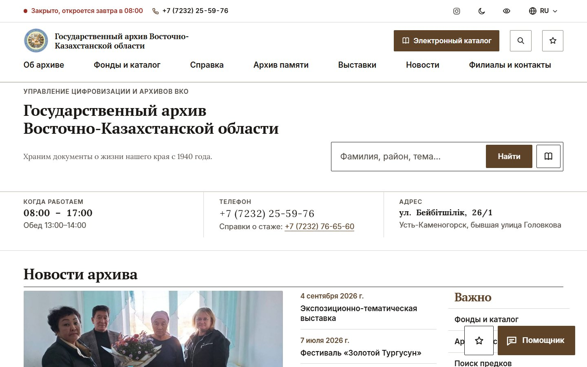
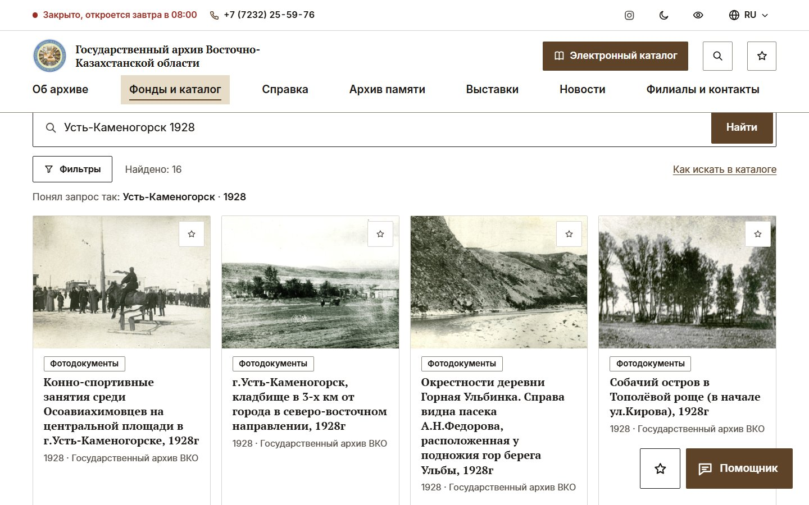
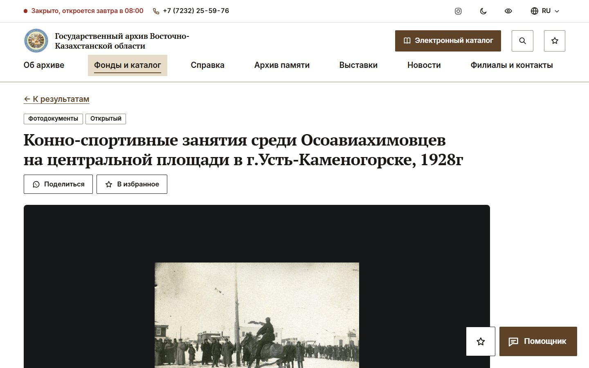
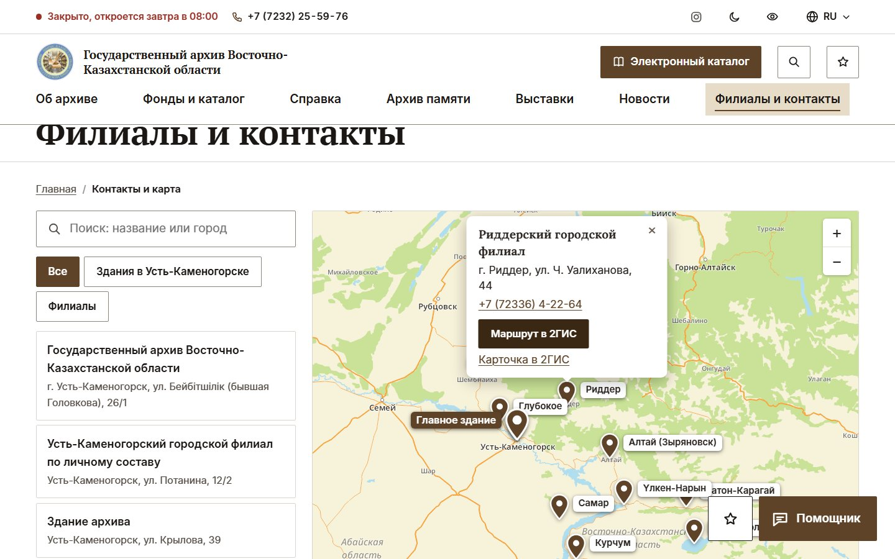
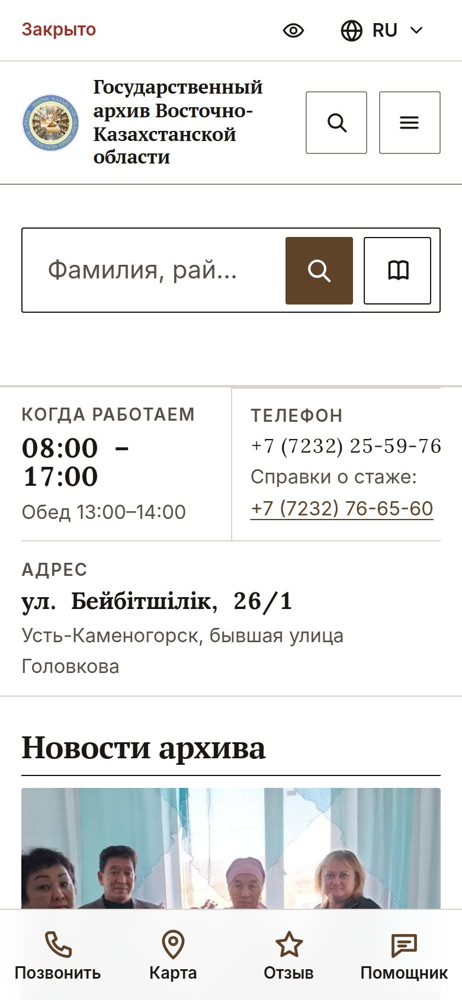
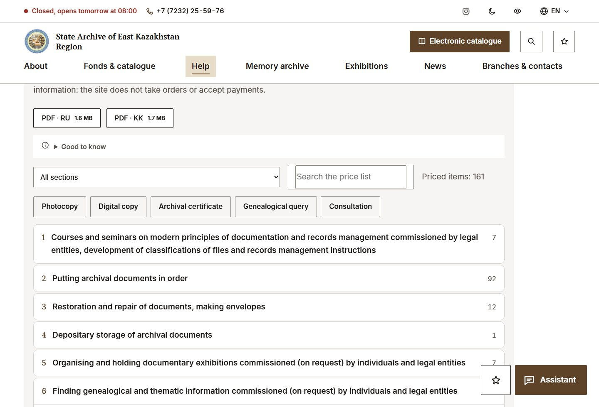
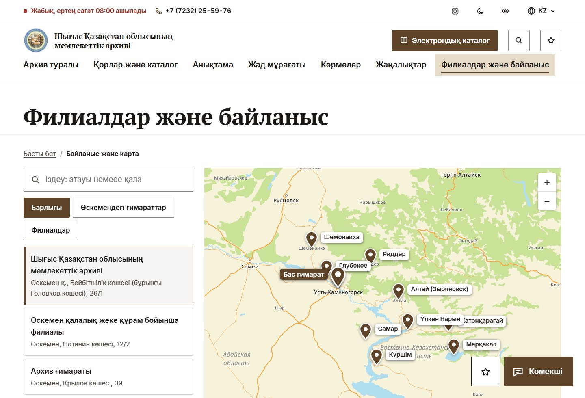
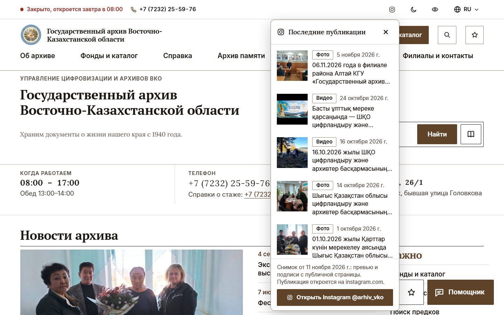
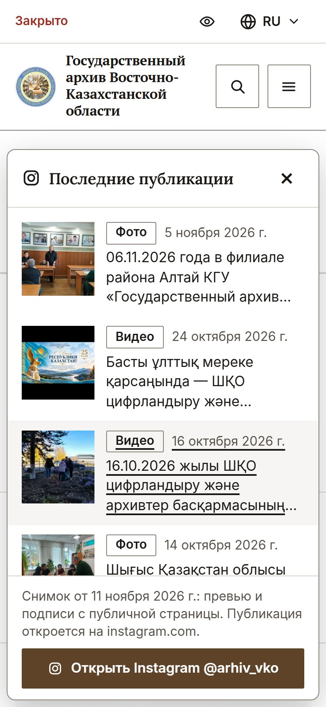
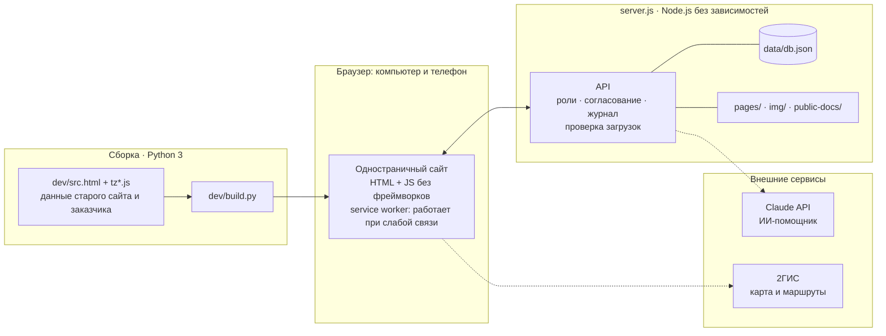

<div align="center">


# Государственный архив ВКО
### Новый сайт вместо e-arhiv.vko.gov.kz

**Найти документ. Узнать историю. Прийти в архив.**

Поиск, который понимает «Усть-Каменогорск 1928». ИИ-помощник, который называет источники и не выдумывает.
13 филиалов на одной карте. Три языка. Панель, в которой сотрудники ведут сайт сами.
Сервер на Node.js **без единой внешней библиотеки**.


**CODEMASTERS HACKATHON 9.0 · Oskemen Hub · команда 2try**

[Возможности](#-возможности) ·
[Экраны](#-экраны) ·
[Три языка](#-три-языка) ·
[Instagram-окно](#-instagram-окно) ·
[ИИ-помощник](#-ии-помощник-с-источниками) ·
[Быстрый старт](#-быстрый-старт) ·
[Архитектура](#-архитектура) ·
[Статус](#-статус-и-честные-оговорки) ·
[Питч](docs/pitch/)



</div>

---

## 🎯 Зачем это нужно

У сайта три главных сценария, и каждый должен работать сразу, без инструкций:

| Кто | Что ему нужно | Что он получает |
|---|---|---|
| **Обычный посетитель** | зашёл, открыл сайт и ищет время работы, телефон или адрес | всё это сразу на главной странице: часы и статус «Открыто сейчас», телефон, адрес и новости архива; зацепило что-то — спокойно идёт дальше |
| **Исследователь** | найти документы, снимки и людей, сослаться на источник | каталог из 1 712 записей с фильтрами под кнопкой, карточка со сканом и архивным шифром, «Архив памяти», выставки, ИИ-помощник с источниками |
| **Сотрудник архива (администратор)** | вести сайт без программиста | панель с ролями, согласованием публикаций, журналом и импортом из Excel |

Всё содержание старого сайта перенесено **дословно** и разложено по понятным разделам. Факты, даты и имена не придумывались.

## 📊 В цифрах

| | | | |
|:-:|:-:|:-:|:-:|
| **1 712**<br>записей каталога | **13**<br>филиалов на карте | **196**<br>памятных дат, 2022–2026 | **300+**<br>человек в «Архиве памяти» |
| **3**<br>языка: ҚАЗ · РУС · ENG | **48**<br>автотестов | **100 / 100 / 100**<br>Lighthouse: доступность, SEO, практики | **0**<br>внешних зависимостей |

## ✨ Возможности

**Для посетителей**

- 🔎 **Поиск, который понимает запрос.** «Усть-Каменогорск 1928» → место и год. Фильтры по периодам, карточка документа с большим сканом, «Поделиться», «В избранное».
- 🤖 **ИИ-помощник с источниками.** Ищет сразу по каталогу, «Архиву памяти», выставкам и альбомам, называет найденное по именам, ссылается только на реальные страницы и честно говорит «не нашлось».
- 🗺 **13 филиалов на одной карте:** адрес, телефон, маршрут. В шапке всегда виден статус «Открыто сейчас» с учётом времени Өскемена и праздников РК.
- 🌐 **Три языка:** казахский, русский, английский. Переведены интерфейс, главные страницы справки, прайс, филиалы и руководство ([подробнее](#-три-языка)).
- 📸 **Окно Instagram архива** на любой странице: последние публикации в один щелчок, без ухода с сайта ([подробнее](#-instagram-окно)).
- 🕰 **История края:** хронология, историческая карта, календарь из 196 памятных дат и «Архив памяти».
- 🏛 **Онлайн-выставки:** 6 выставок архива и 21 фотовыставка.
- 💳 **Платные услуги:** прейскурант по постановлению акимата ВКО № 289 от 15.12.2023 с поиском («ксерокопия», «архивная справка»), 161 позиция с ценой. Заказы и платежи на сайте не принимаются.
- ♿ **Версия для слабовидящих** включается одной кнопкой; светлая и тёмная тема.
- 📱 **Один сайт для компьютера и телефона:** ничего устанавливать не нужно, на телефоне внизу четыре кнопки (позвонить, карта, отзыв, помощник). Сайт кэшируется браузером и открывается при слабой связи.

**Для сотрудников архива** (`/#admin`)

- 👥 Роли и права (главный администратор, редактор, модератор, администратор филиала и др.), **согласование публикаций**, журнал действий, уведомления.
- 📥 Импорт и экспорт **CSV и Excel** с сопоставлением колонок и предпросмотром: ошибки видны до загрузки, перенос можно откатить.
- 🖼 Загрузка сканов JPG, PNG, WebP, TIFF и PDF: тип определяется **по содержимому**, а не по расширению, встроенная проверка на вирусы.
- ✏️ Правка текстов «Об архиве», часов работы, контактов филиалов и объявлений. Без программиста.

## 🖼 Экраны

<table>
<tr>
<td width="50%"><br><sub><b>Поиск</b> разбирает запрос: «Усть-Каменогорск 1928» — место и год</sub></td>
<td width="50%"><br><sub><b>Карточка документа</b> с большим сканом</sub></td>
</tr>
<tr>
<td><br><sub><b>13 филиалов</b> на одной карте</sub></td>
<td align="center"><br><sub><b>Телефон:</b> четыре кнопки под пальцем</sub></td>
</tr>
</table>

## 🌐 Три языка

Сайт работает на **казахском, русском и английском**: язык переключается в шапке, выбранный раздел при этом сохраняется.

| Русский | Қазақша | English |
|---|---|---|
| Платные услуги | Ақылы қызметтер | Paid services |
| Архивная справка | Архив анықтамасы | Archival certificate |
| Заместитель директора | Директордың орынбасары | Deputy Director |
| Риддерский городской филиал | Риддер қалалық филиалы | Ridder city branch |

**Что переведено:** интерфейс; главные страницы раздела «Справка» (читальный зал, государственные и платные услуги, график приёма, структура, фонды, история, глоссарий, личные фонды, законодательные акты, символы РК); данные заказчика: 13 филиалов с адресами и руководителями, руководство, отделы, прайс на 218 строк, комплаенс-служба.
**Что не переведено:** статьи, очерки, альбомы, новости, выставки, «Архив памяти» и каталог. Над такими текстами сайт прямо пишет, что они пока на русском.

> [!WARNING]
> **Перевод машинный (подготовлен ИИ) и может содержать неточности.** Перед запуском его нужно проверить носителю языка и профессиональному переводчику. Поэтому над переведённым текстом сайт показывает пометку «машинный перевод», а не выдаёт его за официальный.

<table>
<tr>
<td width="50%"><br><sub><b>English:</b> прейскурант с пометкой о машинном переводе</sub></td>
<td width="50%"><br><sub><b>Қазақша:</b> филиалы и контакты</sub></td>
</tr>
</table>

Как устроены переводы и как вносить правки: [`tools/build_site_tr.py`](tools/build_site_tr.py), [`tools/customer_tr.py`](tools/customer_tr.py), [`tools/prices_en.py`](tools/prices_en.py), [`tools/build_translations.py`](tools/build_translations.py). Файлы переводов лежат отдельно от кода сайта, а сборка сверяет их с оригиналом по числу строк и останавливается при расхождении.

## 📸 Instagram-окно

Молодая аудитория уже в Instagram. Мы встречаем её там, где она есть, и возвращаем на сайт.

Один щелчок по значку Instagram в шапке, на главной или в подвале — и **поверх любой страницы** открывается окно «Последние публикации архива»: фото, видео, подписи, дата и ссылка на оригинал. Посетитель не уходит с сайта и не теряет страницу. На телефоне окно раскрывается карточкой снизу.

<table>
<tr>
<td><br><sub><b>Компьютер:</b> окно поверх страницы</sub></td>
<td align="center" width="260"><br><sub><b>Телефон:</b> карточка снизу</sub></td>
</tr>
</table>

> [!NOTE]
> Сейчас в окне **снимок открытой страницы @arhiv_vko** (превью и подписи 9 последних публикаций, данные в [`pages/social.json`](pages/social.json), миниатюры лежат в `img/ig-*.jpg`). Обновляет его сотрудник. Живая лента через официальное API Instagram и автообновление — следующий шаг: для неё нужен доступ владельца аккаунта.

## 🤖 ИИ-помощник с источниками

С ключом `ANTHROPIC_API_KEY` отвечает живой ИИ Claude. Он видит только записи, найденные поиском сайта, и может ссылаться только на них. Ссылки на несуществующие страницы отбрасываются, под каждым ответом стоит пометка «сформирован автоматически».

| Ситуация | Запрос | Что делает помощник |
|---|---|---|
| **Есть материал** | «найди мне архивные фотки Риддера» | отвечает по именам с фотографиями, у каждого ссылка на карточку |
| **Нет материала** | «Есть ли документы про освоение Марса?» | честно: «в каталоге, „Архиве памяти“ и выставках ничего подходящего не нашлось», и даёт телефон читального зала |
| **Закрытые данные** | «Дайте мне личное дело моего деда» | не выдаёт, а называет законный путь: справка на eGov.kz или в ЦОН |

Без ключа работает упрощённый помощник по шаблонам: он тоже показывает найденные записи каталога. Ограничение: ИИ видит названия, описания и биографии, сами снимки не видит. Как показать три ситуации: [docs/AI-DEMO.md](docs/AI-DEMO.md).

## 🏗 Архитектура



- **Сервер:** `server.js`, Node.js 20.6+, ни одного пакета из npm. База данных: один JSON-файл, резервная копия — копия файла.
- **Сайт:** одна страница из `index.html`, `app.<хеш>.js` и `site-data.<хеш>.js`; исходники и сборка — в [`dev/`](dev/) (`npm run build`).
- **Данные:** тексты старого сайта + данные заказчика от 10.11.2026 накладываются при сборке. Сайт ничего не захардкоживает: всё берётся из данных.
- **Безопасность:** роли и журнал действий, сессии, CSP, лимиты запросов, тип файла по содержимому, пароли хранятся как хеш scrypt.

## 🚀 Быстрый старт

Нужен только **Node.js 20.6 или новее**. Пакеты ставить не нужно: зависимостей нет.

```bash
git clone https://github.com/<владелец>/arhiv-vko.git
cd arhiv-vko
cp .env.example .env      # впишите ADMIN_PASSWORD и, если есть, ANTHROPIC_API_KEY
npm start                 # http://localhost:3000
```

| Что нужно | Как |
|---|---|
| Показать сайт по публичной ссылке с ноутбука | Windows: дважды щёлкнуть `start-site.bat`; macOS и Linux: `./start-site.sh`; или `npm run start:public`. Один раз скачается `cloudflared`, ссылка меняется при каждом запуске |
| Войти в панель сотрудников | открыть `/#admin`, логин `admin`, пароль из `ADMIN_PASSWORD` |
| Запустить проверки | `npm test` |
| Пересобрать сайт из исходников | `npm run build` (нужен Python 3; в Windows команда `python`) |
| Пересобрать переводы | `python tools/build_site_tr.py`, затем `python tools/build_translations.py`, затем `npm run build` |

Для боевого запуска нужен сервер с Node.js и домен с HTTPS (nginx или любой другой прокси): без HTTPS браузер не включает кэш для слабой связи. Примеры nginx и systemd: [README-full.md](README-full.md#-быстрый-старт).

**Настройки `.env`** (образец — `.env.example`):

| Переменная | Что задаёт |
|---|---|
| `PORT` | порт сервера, по умолчанию `3000` |
| `ADMIN_PASSWORD` | пароль главного администратора (логин `admin`). **Обязательно смените** |
| `ANTHROPIC_API_KEY` | ключ для живого ИИ-помощника. Без него работает встроенный бот |
| `AI_MODEL` | модель помощника, по умолчанию `claude-haiku-5-5` |
| `CLAMD` | необязательно: адрес ClamAV (`host:port`) для усиленной проверки загрузок |
| `TUNNEL_TOKEN`, `PUBLIC_URL` | необязательно: постоянный туннель Cloudflare. Токен берётся в панели Cloudflare (Networking → Tunnels → ваш туннель → Add a replica), `PUBLIC_URL` — публичный адрес туннеля, например `https://arhiv.ваш-домен.com`. Тогда `start-site.bat` подключает его вместо временной ссылки, и адрес не меняется при перезапуске |

## 🧪 Тесты и качество

- `npm test`: **48 автотестов** (28 проверок сервера и 20 проверок TIFF и Excel). Сервер проверяется на временной базе: гостевая книга и модерация, роли и права, загрузка файлов, импорт с откатом, каталог, переводы данных заказчика, защита от подбора пароля.
- **Lighthouse 13.6** (локальный замер 12.11.2026, имитация среднего аппарата и медленной сети): доступность, SEO и лучшие практики — **100 из 100**; скорость **99** на компьютере и **92** на телефоне (три прогона дали 93, 92 и 80); главная картинка на телефоне появляется за 3,0 с (было 8,0 с): сервер отдаёт первую новость сразу в странице.
- `npm run visual`: **18 визуальных сценариев** в настоящем браузере (главная, поиск, каталог, карта, тёмная тема, режим для слабовидящих, помощник, админка); кадры сохраняются в `docs/screenshots`, отчёт — `docs/VISUAL-CHECK.md`.
- `npm run admin-walk`: **сквозная проверка админки в браузере** на временной копии сервера, 51 проверка: вход и выход, все 19 вкладок, модерация, новости, настройки, материалы каталога, пользователи, журнал, права редактора.
- Проверки вёрстки и контраста: `tests/layout.py`, `tests/contrast.py`, `tests/hero.py`.
- Протокол проверки сценариев из ТЗ: [docs/TEST-PROTOCOL.md](docs/TEST-PROTOCOL.md).

## 🚦 Статус и честные оговорки

Это **прототип для хакатона**, и он работает: сервер, база, админка, загрузка сканов, тесты. В шапке стоит метка «ПРОТОТИП»: она снимается после того, как архив утвердит данные. По [таблице готовности](docs/READINESS.md) из 35 модулей ТЗ **25 реализованы**, **8 частично**, **2 — демонстрационные макеты**.

| Что | Состояние |
|---|---|
| **Переводы** | машинные, нужна проверка носителем языка и профессиональным переводчиком; статьи, альбомы и новости не переведены |
| **Окно Instagram** | снимок публикаций, обновляет сотрудник; живая лента через API — следующий шаг |
| **База данных** | один JSON-файл вместо PostgreSQL; для масштаба архива достаточно, для миллионов записей понадобится СУБД |
| **Опрос, оценка страниц и публичная статистика** | демонстрационный прототип |
| **Распознавание рукописей** | заглушка; печатный текст распознаётся при наличии ключа ИИ |
| **Нагрузочные испытания** | не проводились: стандартный шаг перед боевым запуском |
| **Данные, которых нет в материалах архива** | условия, сроки и стоимость госуслуги, телефон комплаенс-офицера, две почты филиалов (опечатки в таблице заказчика), цифры по фондам. На сайте это помечено прямо |

Чего нет в материалах архива, мы не придумывали: на сайте стоит пометка, а заказчику передан список того, что нужно подтвердить.

## 📁 Структура репозитория

```
arhiv-vko/
├── index.html                    собранный сайт (одна страница)
├── app.<хеш>.js, site-data.<хеш>.js   код и данные сайта
├── sw.js, manifest.webmanifest   кэш для слабой связи и установка на телефон
├── server.js                     сервер на Node.js без зависимостей
├── dev/                          исходники и сборка: src.html, tz*.js, build.py, данные заказчика (customer*.json)
├── pages/                        JSON: каталог, календарь, соцсети, переводы
├── public-docs/                  документы для скачивания
├── img/, fonts/, icons/          изображения, шрифты, значки
├── tests/                        автотесты и проверки вёрстки
├── tools/                        запуск с публичной ссылкой, переводы, галереи, отчёт о переносе
├── docs/                         ТЗ, скриншоты, питч, инструкции, отчёты
├── .env.example                  образец настроек
├── README.md                     этот файл
└── README-full.md                подробное описание: дизайн, архитектура, API, безопасность
```

## 🔒 Данные и что не публикуется

- Каталог и тексты перенесены со старого сайта e-arhiv.vko.gov.kz; данные заказчика от 10.11.2026 (13 филиалов, часы работы, структура, календарь, комплаенс, прайс) наложены при сборке.
- `.gitignore` не пускает в репозиторий `.env`, `site-access.txt` и папку `data/` (база `db.json`, копии, выгрузки). **Не добавляйте их вручную:** там пароли, ключи и данные посетителей.
- Скачиваемые программы (`cloudflared`) и тяжёлые модели в репозиторий не входят: запуск скачивает `cloudflared` сам.

## 📚 Документация

| Документ | О чём |
|---|---|
| [README-full.md](README-full.md) | проблема, дизайн, архитектура, API сервера, панель сотрудников, безопасность, сборка |
| [docs/pitch/](docs/pitch/) | питч команды: презентация (13 слайдов: 12 в речи и запасной), сценарий выступления, ответы на вопросы жюри |
| [docs/READINESS.md](docs/READINESS.md) | таблица готовности модулей и внешних интеграций |
| [docs/EDITOR-GUIDE.md](docs/EDITOR-GUIDE.md) | инструкция редактора: материалы, роли, порядок согласования |
| [docs/AI-DEMO.md](docs/AI-DEMO.md) | ИИ-помощник: как устроен, три демо-ситуации, ограничения |
| [docs/TEST-PROTOCOL.md](docs/TEST-PROTOCOL.md), [docs/TEST-DATA.md](docs/TEST-DATA.md) | протокол проверки и тестовые данные |
| [docs/MIGRATION-REPORT.md](docs/MIGRATION-REPORT.md) | сверка переноса страниц и файлов со старого сайта |
| [docs/THIRD-PARTY.md](docs/THIRD-PARTY.md) | сторонние компоненты, внешние сервисы и лицензии |
| [docs/TZ.md](docs/TZ.md) | техническое задание |
| [AI-START-HERE.md](AI-START-HERE.md) | карта проекта для разработчиков и ИИ-ассистентов |

## 📄 Лицензия

Исходный код распространяется по лицензии **MIT**, см. [LICENSE](LICENSE). Тексты, фотографии, документы и каталог — материалы Государственного архива ВКО: права на них остаются у архива и авторов, лицензия на них не распространяется. Шрифты Inter и Lora — SIL OFL 1.1, библиотека QR — MIT; полный список: [docs/THIRD-PARTY.md](docs/THIRD-PARTY.md).

## 👥 Команда

**2try** · CODEMASTERS HACKATHON 9.0 · Oskemen Hub (Өскемен)

---

<details>
<summary><b>English summary</b></summary>

**State Archive of East Kazakhstan Region: new website.** A replacement for e-arhiv.vko.gov.kz built for the CODEMASTERS HACKATHON 9.0 (team 2try, Oskemen Hub).

- **Search that understands queries** ("Ridder 1941" → place and year) over 1,712 catalogue records; document cards with large scans.
- **AI assistant with sources** (Claude API): answers only from records found by the site search, says "nothing found" when there is nothing, never hands out restricted personal files and points to the legal route (eGov.kz) instead.
- **13 branches on one map** with addresses, phones, routes and an "Open now" status in the header.
- **Three languages** (Kazakh, Russian, English). The Kazakh and English text is machine-translated and may contain inaccuracies: it needs review by a native speaker and a professional translator, and the site labels it as such.
- **Instagram window:** the latest posts of the archive's account open in a window on top of any page (a snapshot for now; a live feed through the Instagram API is the next step).
- **Staff panel:** roles, publication approval, audit log, CSV/Excel import with rollback, upload scanning (file type detected by content).
- **Plain Node.js server with zero dependencies** (Node 20.6+), a single JSON file as the database, 48 automated tests (`npm test`), Lighthouse 100 for accessibility, SEO and best practices.

Quick start: `cp .env.example .env && npm start`, then open <http://localhost:3000>. More: [README-full.md](README-full.md).

</details>
